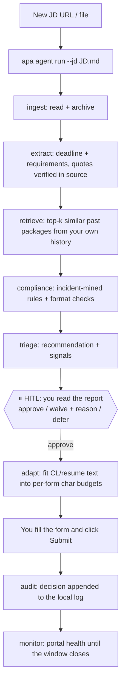

# APA User Guide

> Your job-application operations agent for Singapore: you bring your
> experience and your preferences; the agent finds matching public postings,
> checks every document it helps produce against incident-mined rules, and
> prepares a submission package — then **stops**. You review and you click
> Submit. Always.

## 0. The journey at a glance

```
 ┌─ 1. Install ────────────────────────────────────────────────┐
 │  ┌─ 2. Profile: record YOUR experience once (single truth) ┐│
 │  │  ┌─ 3. Preferences: roles, salary, locations, channels ┐││
 │  │  │  ┌─ 4. Discover: match public postings ─────────────┐│││
 │  │  │  │  ┌─ 5. Pipeline: per posting (below) ────────────┐││││
 │  │  │  │  │  ingest → extract → retrieve(RAG)             │││││
 │  │  │  │  │  → compliance → triage → ⏸ you decide         │││││
 │  │  │  │  │  → adapt(char budgets) → audit                │││││
 │  │  │  │  └────────────────────────────────────────────────┘││││
 │  │  │  └─────────────────────────────────────────────────────┘│││
 │  │  └──────────────────────────────────────────────────────────┘││
 │  └──────────────────────────────────────────────────────────────┘│
 └───────────────────────────────────────────────────────────────────┘
        6. You submit on the portal · 7. Monitor · 8. Ledger update
```

| Step | Status |
|---|---|
| 1 Install | ✅ this guide §1 |
| 2 Profile / 3 Preferences | 🚧 `profile.yaml` format defined in §2; loader ships next |
| 4 Discovery (search public postings) | 🚧 URL-list ingest ships first (§4); portal-search adapters follow |
| 5 Pipeline (extract → … → audit) | ✅ shipped |
| 6-8 Submit / Monitor / Ledger | ✅ shipped (Submit is always you) |
| 9 Post-submission (confirmations, interviews) | 📐 designed (ROADMAP R6): read-only email audit, interview-intake, preparation briefs |

## 1. Install

```bash
git clone <this repo> && cd application-pipeline-agent
conda create -n apa python=3.11 && conda activate apa
pip install -e ".[dev,eval]"
pytest -q    # sanity check
```

## 2. Record your profile (once — the single source of truth)

Create `profile.yaml` in your workspace. Everything the agent produces
(tailoring, triage, drafts) is derived from this file — never invented:

```yaml
# profile.yaml — YOUR facts only. The agent never adds a credential,
# employer, or metric that is not here (enforced by the no-new-claims
# draft fitter and the provenance-checked extractor).
identity:
  name: "Jane Tan"                  # as it should appear in documents
  work_authorization: "Singapore Citizen"   # or PR / EP holder / needs sponsorship
  contact:
    email: "jane.tan@example.com"
    phone: "+65 9xxx xxxx"          # masked automatically on egress
    location: "Singapore"

experience:                         # reverse chronological
  - employer: "Tech Co"
    title: "Senior AI Engineer"
    start: "2019-10"
    end: "present"
    highlights:
      - "Delivered RAG pipelines serving N internal teams"
      - "Improved retrieval accuracy by ten percentage points"

skills:
  - python
  - langgraph
  - rag
  - faiss

metrics_ledger:                     # every number you may cite, with its source
  - claim: "ten percentage points"
    source: "production telemetry, verified 2026-09"

preferences:                        # §3 below
  keywords: ["AI engineer", "LLM", "agentic"]
  min_score: 3.5
  channels: ["careers-gov", "mycareersfuture"]
```

> **Loader status:** the schema above is the contract; the YAML loader ships
> with the next milestone. Until then, the CLI reads the same facts from
> your files directly.

## 3. Set your preferences

The `preferences` block drives discovery and triage:

| Field | Effect |
|---|---|
| `keywords` | matching terms for discovery and relevance scoring |
| `min_score` | postings below your threshold are filed as `skip`, not `ready` |
| `channels` | which channels discovery watches (careers-gov / mycareersfuture / jobstreet) |
| `deadline_buffer_days` | default 2 for government postings (rule: deadline-buffer) |

## 4. Discover public postings

Three ingest paths, in increasing automation — **all of them keep you inside
the portals' terms of service**:

| Path | How | Status |
|---|---|---|
| **URL list** (recommended first) | browse the public portals (Careers@Gov, MyCareersFuture — both free and public), copy the posting URLs into a `discovered.txt` list; APA ingests each | ✅ ships now |
| **Query-assisted review** | `apa retrieve search` against your indexed history to spot postings similar to ones you already rated | ✅ ships now |
| Portal-search adapters | structured search per channel profile | designed (channel_profiles/ documents each portal's public surface) |

```bash
# discovered.txt: one posting URL per line, pasted from the public portals
apa agent run --jd discovered.txt --thread week-42
```

## 5. The per-posting pipeline

For every posting that passes your preferences, `apa agent run` produces the
full report and pauses for you (§4 of the deep dive below), then `adapt`
fits your text into each form's character budget, and the compliance engine
re-checks your final text. Full walkthrough with diagrams:
see [the pipeline section](#6-the-per-posting-pipeline-deep-dive) and the
[channel profiles](channel_profiles/).

## 6. The per-posting pipeline (deep dive)



### LLM backends

| Backend | Env | Data boundary |
|---|---|---|
| Local llama.cpp (default) | `APA_LLM_BACKEND=local` | stays on your machine |
| Cloud-private (Bedrock In-Region / Azure) | `APA_LLM_BACKEND=cloud` + `APA_ALLOW_CLOUD_JUDGE=1` | egress — PII gate applies |
| WorkBuddy desktop models | `APA_LLM_BACKEND=workbuddy` | egress — PII gate applies |

Many core features (compliance, format, probing, audit) are fully
deterministic and need **no LLM at all**.

### The human decision

```bash
apa agent resume --thread yourid-001 --action approve --reason "deadline verified" --jd new_JD.md
```

## 7. Privacy gate

Any cloud/workbuddy call with uncleared material runs the Presidio gate
first: NRIC / phone / email / names are detected (a Singapore-NRIC
recognizer is built in) and the call is **blocked** with a finding list.
`PIIGate.mask(text)` produces a redacted version for review.

## 8. Command reference

| Command | Purpose | Needs LLM |
|---|---|---|
| `apa status` | milestone + next step | no |
| `apa compliance check` | incident-mined + format rules, line-level findings | no |
| `apa probe run/evaluate` | portal health + state machine | no |
| `apa retrieve index/search` | RAG over your own history | local embedding model |
| `apa extract` | JD facts with provenance | yes |
| `apa agent run/resume` | the end-to-end loop | yes |
| `apa review audit` | audit a third-party review opinion | no |
| `apa adapt` (Python API) | per-form budget fitting + final review | no |
| `apa monitor` / `apa web` | dashboards | no |

## 9. Troubleshooting

| Symptom | Cause | Fix |
|---|---|---|
| `NoBackendAvailable` in auto mode | no LLM endpoint reachable | start llama.cpp, or set the backend explicitly |
| Chinese/garbled console output | Windows GBK locale | the CLI reconfigures to UTF-8 itself; for subprocesses set `PYTHONIOENCODING=utf-8` |
| `probe` marks everything `blocked` | portal anti-scraping | expected on some channels; do not retry aggressively |
| extraction misses list fields | small local model boundary | use a stronger backend for that field; the need-human flag fires correctly |
| ledger update rejected | unknown field or ID | field names must match the ledger header; use the query tool to inspect |

## 10. What APA will never do

- Submit an application.
- Write to your ledger outside the audited channel.
- Send material to a cloud model without the PII gate.
- Invent text you did not write (the fitter deletes; it never adds).
